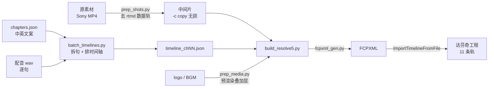

# 寄方堂人参短视频 · 达芬奇草稿自动化流水线

**把「素材 + 文案 + 配音」变成一版可直接渲染的达芬奇工程 —— 全脚本化、一条命令、6 道预检。**


> 竖屏 1080×1920 @30fps ｜ 9 条视频轨 + 2 条音频轨 ｜ 单章 ≈16s ｜ 一条命令约 4 分钟出工程
>
> 字幕为 Fusion Text+，以**配音为时长基准**，配音 / 中英字幕 / 镜头三者严格等长。

---

## 一、它解决什么问题

一条人参竖屏短视频的规格是固定的：档案卡三轨 + 双 logo + 中英字幕 + 引文竖排 + 配音 + BGM + 段间闪黑。

手工在达芬奇里对齐这 11 条轨、7 段字幕、15 条闪黑，一改文案就全部重排。
这个项目把这套规格**写成代码**，于是：

| | 手工 | 本项目 |
|---|---|---|
| 出一章草稿 | 数小时，且容易错位 | 一条命令，约 4 分钟 |
| 文案改动 | 全轨手动重排 | 重跑即可 |
| 排版是否溢出 | 必须导出看一眼 | **不渲染就能算出来**（第 6 节） |
| 做 12 章 | ×12 的工作量 | 循环 |

---

## 二、技术难点与解法

这一节是项目的主体。每一条都是实测踩出来的，不是设计纸上推演的。

### 1. Sony 原素材的数据轨会让 FCPXML 导入失败

达芬奇脚本 API 的 `AppendToTimeline` 摆进去的片段**不持久化**（内存里能读到、`SaveProject()` 返回 True，
一切换工程就全空）。唯一可靠路径是 `MediaPool.ImportTimelineFromFile(FCPXML)`。

但 Sony 原素材直接喂 FCPXML 会导入失败。逐项排除后的实测结论：

| 素材 | FCPXML 导入 |
|---|---|
| 原始 Sony 4K 10bit 4:2:2（含 `rtmd` 实时元数据轨） | ❌ 失败 |
| 同一文件**只去掉数据轨**、视频 `-c copy` 原样复制 | ✅ **成功** |
| 只去掉音轨、保留数据轨 | ❌ 失败 |
| 重编码成 4K 8bit 4:2:0 | ✅ 成功 |

→ **不是 10bit 4:2:2 的问题，是那条 `rtmd` 数据轨。**

解法（`prep_shots.py`）是无损重封装，画质零损失、耗时几秒：

```bash
ffmpeg -y -i in.MP4 -map 0:v:0 -map 0:a:0? -c copy -movflags +faststart out.MP4
```

### 2. 达芬奇脚本 API 没有关键帧、没有转场

段间 0.5s 闪黑、视频末段 0.3s 渐隐、logo 淡入淡出——这些"随时间变化"的东西 API 写不进去。

解法：**用 ffmpeg 预渲染成素材，再用乘法合成叠上去**。

用「不透明 白→黑 渐变 + `COMPOSITE_MULTIPLY`」实现淡出：乘法里"乘 1 = 不变、乘 0 = 全黑"，
比带 alpha 的 ProRes 4444 更稳（没有 alpha/色彩管理坑），亮度曲线就是线性淡出。

> 附带一条硬约束：静态图当载体不可用（`endFrame` 被忽略，永远 150 帧），所以文字轨载体用**透明 MOV**。

### 3. 以配音为时长基准，三者严格等长

配音是**逐句**合成的 —— 逐句天然给出"字幕换行 + 镜头切换"的锚点，不需要强制对齐。

句数由 `batch_timelines.segments_for()` 统一决定：中文一行放不下的长句在这里拆成两句，
于是**"合成的句数 = 字幕段数 = 镜头段数"永远一致**。

时间语义要小心：**源素材 50fps、时间线 30fps**；FCPXML 里 `start` 按**源帧**算，
`duration` / `offset` 按**时间线帧**算。全部用精确分数秒（`N/30s`）避开帧基歧义。

### 4. 中文超宽 → 拆句，而不是折行

竖屏安全宽 `SUB_SAFE_W = 960`（画面 1080）。实测 30 字中文在 49.1px 字号下是 **1463px**，直接冲出画面。

**不能折行**：中英字幕两轨的基准行心距只有 **61px**，而一个行高 62~70px，第二行中文会压住英文字幕。

解法：在【，、；：—】处把这一句**拆成两段**，英文在子句或词边界同步拆，
于是配音、字幕、镜头一起变成两段，三者仍然严格等长。

英文**可以**折行，但要用平衡折行（`fontsel.wrap_balanced`）而不是贪心：
贪心会留下很短的尾行，字幕上很难看；改成"行数最少"前提下取最均衡的断点。

### 5. Fusion Text+ 的几个静默坑

| 坑 | 现象 | 解法 |
|---|---|---|
| `SetInput` 对**不存在的输入名静默接受** | 样式悄悄不生效 | 用实测白名单 `TEXT_INPUT_IDS` |
| `Font` 必须填**字体族名**，不是文件路径 | 写路径 → Fusion 把路径当文字渲染 + 渲染失败无法导出 | 用 `fontsel.py` 查真实族名 |
| `CharacterSpacing` 是**倍数**不是像素 | 直接把字距像素写进去 → 整行被拉满 | `1 + 字距px/字号px` 换算 |
| `HorizontalJustificationNew` 默认 `3.0`（两端对齐） | 整行被拉开 | 设 `1.0` 居中 |
| `Size` 的基准是 **696.0**，不是画面高度 1920 | 字号全错 | 用标定草稿 5 档字号拟合（一致性 0.05%） |
| Fusion 归一化 y 是**翻转**的 | 想下移结果上移 | `1 - px_y/H`；多行时 `CenterY -= (行数-1)/2 × 行高/H` |

### 6. 「一次成片」的底气：不渲染就能验证排版

`check_text_layout.py` 用 CoreText（Windows 上走 PIL）取**真实字形宽度**，在**建草稿之前**就算出：

- 每一行是否超过安全宽 → **中文超宽 = 上游漏拆句，直接报错**
- 文字块是否越出画面上下边界
- 中文字幕与英文字幕是否互相压叠

于是"字号/字距/换行/位置"都不再依赖"导出看一眼"。

---

## 三、流水线



每次构建自动跑 **6 道预检**，任何一道失败就拦住：

| 步 | 脚本 | 检查什么 |
|---|---|---|
| 0/6 | `fontsel.py` | 字体族名能否查到（缺字体 → Fusion 渲染失败） |
| 0/6 | `check_text_layout.py` | 每行像素宽度 + 中文有没有漏拆 + 中英不叠压 |
| 1/6 | `timeline_tool.py --fix --check` | 时长 ≤20s、三者等长、无间隙、未用被排除素材 |
| 2/6 | `prep_media.py` | 生成 logo / 闪黑灰阶 / 黑底 / BGM |
| 3/6 | `build_resolve5.py` | 建草稿 + **18 项回读自检** + 持久化验证 |
| 4/6 | `verify_build.py` | 独立回读（轨名 / 段数 / Fusion / 帧位） |

---

## 四、快速开始

```bash
# 1) 依赖
pip install -r requirements.txt          # pillow, numpy
#    另外需要 ffmpeg，以及 DaVinci Resolve（免费版即可，含脚本 API）

# 2) 准备数据（仓库不含客户内容，用模板自建）
cp media_map.example.json media_map.json     # 章号 -> 原素材目录
cp chapters.example.json  chapters.json      # 中英文案
cp cards.example.json     cards.json         # 档案卡四字段

# 3) 素材无损重封装（去 rtmd 数据轨）
python prep_shots.py --chapter 01

# 4) 一条命令跑完：字体自检 → 排版预检 → 时间轴 → 叠加层 → 建草稿 → 回读验证
python run_chapter.py --chapter 01 --media-dir "<中间片目录>"
```

成功输出 `✅ 全流程通过`，工程名见 `out/last_project.txt`。

> **达芬奇要手动双击启动**并停在项目页。用脚本/命令行拉起来的达芬奇会"降级运行"
> （片段不持久化、导出纯黑）—— 这是实测过的坑，`doctor.py` 就是查这个的。

### 不开达芬奇也能跑的部分

```bash
# 完全独立：不需要素材、不需要 TTS、不需要达芬奇 —— 用示例文案估算各章时长预算
python batch_timelines.py --plan-only

# 下面几条需要先生成 out/timeline_ch01.json（第 4 步跑完就有）
python timeline_tool.py out/timeline_ch01.json --check                 # 时间轴自检
python check_text_layout.py --timeline out/timeline_ch01.json          # 排版预检
python build_resolve5.py --timeline out/timeline_ch01.json --dry-run   # 打印完整落点计划
```

`--plan-only` 是新克隆下来唯一能直接跑的命令，用示例文案即可验证：

```
校准: 用第01章 0 句**实测**配音回归 dur = 0.06711*len(en) +0.000
  章   题名        编号               句     配音     总长     ±  判定
  01  识参        20260626-39      4  13.90  15.90  0.00  ✅
  02  参须        20260626-25      4  12.14  14.14  0.00  ✅
```

---

## 五、跨平台

本项目同时支持 macOS 与 Windows。平台差异全部在运行时判断，同一份代码两边跑：

| | macOS | Windows |
|---|---|---|
| 字体测量 | CoreText | PIL（Pillow） |
| 达芬奇脚本 API | `/Library/Application Support/...` | `%PROGRAMDATA%\Blackmagic Design\...` |
| 脚本库 | `fusionscript.so` | `fusionscript.dll` |
| 一键脚本 | `一次成片.sh` | `win\一次成片.bat` |
| 装环境 | — | `win\setup_windows.ps1` |
| 环境体检 | `doctor.py` | `win\doctor_windows.py`（8 项） |

`win/patch_for_windows.py` 是把 mac 版脚本移植到 Windows 的幂等补丁，也可以用来把本仓库
迁到另一台机器。

---

## 六、项目结构

```
editlib.py             共享常量 / 规格 / 坐标换算 / 时间轴校验
run_chapter.py         一章一条命令跑完（串起 6 道预检）
batch_timelines.py     文案 -> 时间轴 JSON（含中文超宽拆句）
timeline_tool.py       时间轴离线校验 / 修正 / 重建
prep_shots.py          原素材无损重封装（去 rtmd 数据轨）
prep_media.py          预渲染叠加层（logo / 闪黑 / BGM）
build_resolve5.py      达芬奇草稿构建器（FCPXML 路径 + 回读自检）
fcpxml_gen.py          落点计划 -> FCPXML
verify_build.py        独立回读验证
check_text_layout.py   排版预检（不渲染就能算准）
fontsel.py             字体族名解析 + 真实字形测宽
synth.py / synth_sentences.py / clean_voice.py   TTS 配音与清洗
doctor.py              环境体检
win/                   Windows 启动脚本与移植补丁
demo/demo.gif          成片效果
```

---

## 七、已知限制

- **仓库不含素材**：`assets/`（logo、BGM）、`fonts/`（思源宋体）、配音 wav、文案 JSON 均不入库
  （体积 / 客户资产），需按第 4 节自备。
- **配音依赖外部 TTS 服务**：默认对接本机 `http://127.0.0.1:3900`（OpenAI 风格 `/v1/audio/speech`）。
  任何兼容该接口的服务都能接，改环境变量 `VOICESTUDIO_API` 即可。
- **英文衬线体**：macOS 用系统自带的 Didot；Windows 需自备一个 Didone 衬线体并设
  `JIFANGTANG_FONT_EN` / `JIFANGTANG_FONT_EN_FAMILY`。
- **安全约束**：脚本内**刻意不调用** `StartRendering` / `ExportCurrentFrameAsStill`，
  它们会把达芬奇留在交付页放大预览导致界面卡死。要看效果请手动导出。

---

## License

MIT
